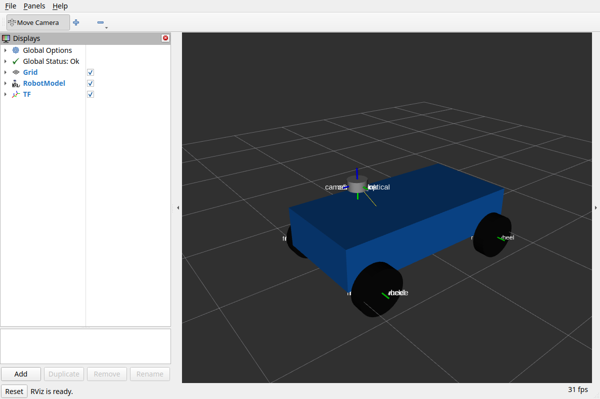

# ПР06 — системы координат модели `course_ackermann`

Документ собран скриптом `evidence/pr06/scripts/render.py`: таблица связей — из развёрнутого
`src/course_description/urdf/vehicle.urdf.xacro`, блоки `text` — реальный вывод команд из
`evidence/pr06/logs/` (опыт — `scripts/experiment.sh`, проверки модели — `scripts/tests.sh`).

- Среда: Ubuntu 24.04.2 LTS (ядро `6.14.0-37-generic`), `ROS_DISTRO=jazzy ROS_DOMAIN_ID=16 RMW=default`.
- Исправная модель: ветка `main`, коммит `c5af45a89b9ffebdbd7830ecc4dc9600d573afa4`, прогон 2026-10-18T23:04:09+07:00.
- Дефект: ветка `pr06-defect`, коммит `2b3015b327e8e5dacb5723b1d4705cd6cda57160`, прогон 2026-10-18T23:00:45+07:00.
- Размеры — из `.course-kit/v1/models/course_ackermann/model.sdf`: база 0.8 м, колея 0.62 м,
  радиус колеса 0.12 м (Xacro-свойства `wheelbase`, `track`, `wheel_radius`); единицы СИ, оси REP-103.

## Связи дерева и их владельцы

Корень — `base_footprint` (REP-105: проекция `base_link` на землю, без инерции: KDL в
robot_state_publisher не принимает инерцию у корня). `map` и `odom` пока никто не публикует.
Каждое ребро публикует ровно один участник — robot_state_publisher; подвижные рёбра он считает по
`/joint_states`, у которых тоже один издатель.

| Родитель | Потомок | Сочленение | Тип | origin xyz, м | origin rpy, рад | Потомок в base_link, м | Владелец публикации |
|---|---|---|---|---|---|---|---|
| `base_footprint` | `base_link` | `base_footprint_to_base` | fixed | 0, 0, 0.12 | 0, 0, 0 | 0, 0, 0 | robot_state_publisher → `/tf_static` (из `robot_description`, один раз, transient local) |
| `base_link` | `camera_link` | `base_to_camera` | fixed | 0.28, 0, 0.38 | 0, 0, 0 | 0.28, 0, 0.38 | robot_state_publisher → `/tf_static` (из `robot_description`, один раз, transient local) |
| `base_link` | `imu_link` | `base_to_imu` | fixed | 0.28, 0, 0.38 | 0, 0, 0 | 0.28, 0, 0.38 | robot_state_publisher → `/tf_static` (из `robot_description`, один раз, transient local) |
| `base_link` | `lidar_link` | `base_to_lidar` | fixed | 0.28, 0, 0.38 | 0, 0, 0 | 0.28, 0, 0.38 | robot_state_publisher → `/tf_static` (из `robot_description`, один раз, transient local) |
| `camera_link` | `camera_link_optical` | `camera_to_optical` | fixed | 0, 0, 0 | -1.571, 0, -1.571 | 0.28, 0, 0.38 | robot_state_publisher → `/tf_static` (из `robot_description`, один раз, transient local) |
| `base_link` | `front_left_knuckle` | `front_left_steering_joint` | revolute | 0.4, 0.31, 0 | 0, 0, 0 | 0.4, 0.31, 0 | robot_state_publisher → `/tf` по `/joint_states` (в опыте их публикует `zero_joint_states`) |
| `front_left_knuckle` | `front_left_wheel` | `front_left_wheel_joint` | continuous | 0, 0, 0 | 0, 0, 0 | 0.4, 0.31, 0 | robot_state_publisher → `/tf` по `/joint_states` (в опыте их публикует `zero_joint_states`) |
| `base_link` | `front_right_knuckle` | `front_right_steering_joint` | revolute | 0.4, -0.31, 0 | 0, 0, 0 | 0.4, -0.31, 0 | robot_state_publisher → `/tf` по `/joint_states` (в опыте их публикует `zero_joint_states`) |
| `front_right_knuckle` | `front_right_wheel` | `front_right_wheel_joint` | continuous | 0, 0, 0 | 0, 0, 0 | 0.4, -0.31, 0 | robot_state_publisher → `/tf` по `/joint_states` (в опыте их публикует `zero_joint_states`) |
| `base_link` | `rear_left_wheel` | `rear_left_wheel_joint` | continuous | -0.4, 0.31, 0 | 0, 0, 0 | -0.4, 0.31, 0 | robot_state_publisher → `/tf` по `/joint_states` (в опыте их публикует `zero_joint_states`) |
| `base_link` | `rear_right_wheel` | `rear_right_wheel_joint` | continuous | -0.4, -0.31, 0 | 0, 0, 0 | -0.4, -0.31, 0 | robot_state_publisher → `/tf` по `/joint_states` (в опыте их публикует `zero_joint_states`) |

Камера, лидар и IMU в SDF закреплены в одной точке, поэтому их `origin` совпадают.
`camera_link_optical` (REP-103: z вперёд, x вправо, y вниз) повёрнут относительно `camera_link`
на rpy = (-1.571, 0, -1.571) рад.

## Модель в RViz

`ros2 launch course_description display.launch.py rviz:=true zero_joint_states:=true`,
Fixed Frame `base_link`, Global Status: Ok; колёса видны благодаря `/joint_states`.



## Одна связь: `tf2_echo base_link lidar_link`

Исправная модель:

```text
$ timeout -s INT 6 ros2 run tf2_ros tf2_echo base_link lidar_link
At time 0.0
- Translation: [0.280, 0.000, 0.380]
- Rotation: in RPY (radian) [0.000, -0.000, 0.000]
... (полностью: evidence/pr06/logs/fixed/2-tf2-echo.txt)
[exit=124, 23:04:35.690]
```

С дефектом (родитель лидара — `camera_link`, origin прежний):

```text
$ timeout -s INT 6 ros2 run tf2_ros tf2_echo base_link lidar_link
At time 0.0
- Translation: [0.560, 0.000, 0.760]
- Rotation: in RPY (radian) [0.000, -0.000, 0.000]
... (полностью: evidence/pr06/logs/defect/2-tf2-echo.txt)
[exit=124, 23:01:02.464]
```

## Всё дерево: `view_frames`

Рёбра графа из `frames.gv` (PDF — `logs/fixed/frames.pdf` и `logs/defect/frames.pdf`).
`view_frames` слушает tf 5 с; колёса без `/joint_states` в него не попадают.

```text
# исправная модель
base_footprint -> base_link
base_link -> camera_link
base_link -> imu_link
base_link -> lidar_link
camera_link -> camera_link_optical

# дефект
base_footprint -> base_link
base_link -> camera_link
base_link -> imu_link
camera_link -> lidar_link
camera_link -> camera_link_optical
```

## `/tf_static` целиком: `ros2 topic echo /tf_static --once`

```text
$ timeout 5 ros2 topic echo /tf_static --once
    frame_id: base_footprint
  child_frame_id: base_link
    translation:
      x: 0.0
      y: 0.0
      z: 0.12
    rotation:
      x: 0.0
      y: 0.0
      z: 0.0
      w: 1.0
    frame_id: base_link
  child_frame_id: camera_link
    translation:
      x: 0.28
      y: 0.0
      z: 0.38
    rotation:
      x: 0.0
      y: 0.0
      z: 0.0
      w: 1.0
    frame_id: base_link
  child_frame_id: imu_link
    translation:
      x: 0.28
      y: 0.0
      z: 0.38
    rotation:
      x: 0.0
      y: 0.0
      z: 0.0
      w: 1.0
    frame_id: base_link
  child_frame_id: lidar_link
    translation:
      x: 0.28
      y: 0.0
      z: 0.38
    rotation:
      x: 0.0
      y: 0.0
      z: 0.0
      w: 1.0
    frame_id: camera_link
  child_frame_id: camera_link_optical
    translation:
      x: 0.0
      y: 0.0
      z: 0.0
    rotation:
      x: 0.5
      y: -0.4999999999999999
      z: 0.5
      w: -0.5000000000000001
... (полностью: evidence/pr06/logs/fixed/4-tf-static.txt)
[exit=0, 23:04:48.752]
```

С дефектом у `lidar_link` другой родитель при том же смещении:

```text
$ timeout 5 ros2 topic echo /tf_static --once
    frame_id: base_footprint
  child_frame_id: base_link
    frame_id: base_link
  child_frame_id: camera_link
    frame_id: base_link
  child_frame_id: imu_link
    frame_id: camera_link
  child_frame_id: lidar_link
    frame_id: camera_link
  child_frame_id: camera_link_optical
... (полностью: evidence/pr06/logs/defect/4-tf-static.txt)
[exit=0, 23:01:12.019]
```

## Один владелец у каждого ребра

```text
$ ros2 node list
/robot_state_publisher
[exit=0, 23:04:29.188]

$ ros2 topic info /tf_static --verbose
Publisher count: 1
Node name: robot_state_publisher
Node namespace: /
  Reliability: RELIABLE
  Durability: TRANSIENT_LOCAL
Subscription count: 0
... (полностью: evidence/pr06/logs/fixed/1-graph.txt)
[exit=0, 23:04:29.558]
```

С `/joint_states` (нода `zero_joint_states`) колёса и кулаки появляются в `/tf`; у `/tf` и
`/joint_states` по одному издателю:

```text
$ ros2 topic info /joint_states --verbose
Publisher count: 1
Node name: zero_joint_states
Node namespace: /
  Reliability: RELIABLE
  Durability: VOLATILE
Subscription count: 1
Node name: robot_state_publisher
Node namespace: /
  Reliability: BEST_EFFORT
  Durability: VOLATILE
... (полностью: evidence/pr06/logs/fixed/5-moving.txt)
[exit=0, 23:04:54.195]

$ ros2 topic info /tf --verbose
Publisher count: 1
Node name: robot_state_publisher
Node namespace: /
  Reliability: RELIABLE
  Durability: VOLATILE
Subscription count: 0
... (полностью: evidence/pr06/logs/fixed/5-moving.txt)
[exit=0, 23:04:54.575]

$ timeout -s INT 6 ros2 run tf2_ros tf2_echo base_link front_left_wheel
- Translation: [0.400, 0.310, 0.000]
- Translation: [0.400, 0.310, 0.000]
- Translation: [0.400, 0.310, 0.000]
... (полностью: evidence/pr06/logs/fixed/5-moving.txt)
[exit=124, 23:05:00.705]
```

## Сломать: `lidar_link` прикреплён к `camera_link` (ветка `pr06-defect`)

Один коммит (`evidence/pr06/defect.patch`): у вызова макроса лидара `parent="camera_link"`,
`origin` не менялся.

```text
$ git log --oneline -3
2b3015b PR06: lidar_link attached to camera_link
c5af45a PR06: robot model and display launch
cdf308e PR05: record evidence
[exit=0, 23:00:45.085]

$ git diff HEAD~1 HEAD -- src
diff --git a/src/course_description/urdf/vehicle.urdf.xacro b/src/course_description/urdf/vehicle.urdf.xacro
index aac3b39..d775c19 100644
--- a/src/course_description/urdf/vehicle.urdf.xacro
+++ b/src/course_description/urdf/vehicle.urdf.xacro
@@ -160,7 +160,7 @@
       <origin xyz="0 0 0"/>
     </xacro:box_inertial>
   </xacro:sensor>
-  <xacro:sensor name="lidar_link" joint="base_to_lidar">
+  <xacro:sensor name="lidar_link" joint="base_to_lidar" parent="camera_link">  <!-- ДЕФЕКТ ПР06: parent лидара -->
     <geometry><cylinder radius="${lidar_radius}" length="${lidar_length}"/></geometry>
     <xacro:cylinder_inertial mass="${sensor_mass}" radius="${lidar_radius}" length="${lidar_length}">
       <origin xyz="0 0 0"/>
[exit=0, 23:00:45.088]
```

`check_urdf` такое дерево принимает: структура допустима, смысл — нет.

```text
$ check_urdf /tmp/vehicle.urdf
robot name is: course_ackermann
---------- Successfully Parsed XML ---------------
root Link: base_footprint has 1 child(ren)
    child(1):  base_link
        child(1):  camera_link
            child(1):  lidar_link
            child(2):  camera_link_optical
        child(2):  imu_link
        child(3):  front_left_knuckle
            child(1):  front_left_wheel
        child(4):  front_right_knuckle
            child(1):  front_right_wheel
        child(5):  rear_left_wheel
        child(6):  rear_right_wheel
[exit=0]
```

## Доказать: тот же тест до и после

Тесты проверяют ожидаемого родителя и положение каждого сенсора в `base_link` (композиция origin
вдоль цепочки), а не только структуру. На ветке дефекта упавших тестов: 3, на `main`
проходят все; полный вывод — `evidence/pr06/model-check.txt` и `logs/model-check-defect.txt`.

| Тест | Ошибка на ветке дефекта | main |
|---|---|---|
| `test_expected_parent_and_joint_type[lidar_link]` | `src/course_description/test/test_model.py:69: AssertionError: base_to_lidar` | PASSED |
| `test_sensor_position_in_base_link[lidar_link]` | `src/course_description/test/test_model.py:74: assert (0.56, 0.0, 0.76) == approx((0.28 ...38 ± 3.8e-07))` | PASSED |
| `test_dimensions_match_kit_sdf` | `src/course_description/test/test_model.py:193: AssertionError: lidar_link` | PASSED |

Причина: у сочленения `base_to_lidar` родитель `camera_link`, а origin (0.28, 0, 0.38) задан
относительно родителя, поэтому смещение камеры и лидара складываются: лидар оказывается в
(0.56, 0, 0.76) от `base_link`. Исправление — вернуть `parent` по умолчанию (`base_link`).
